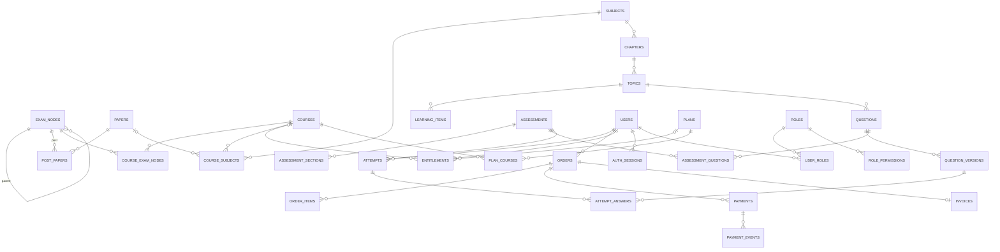

# Database Architecture (PostgreSQL 17)

Status: **v1.0 draft for owner review** (Phase 3). Implemented via Prisma migrations in Phase 4+; raw SQL migrations for
partial indexes, generated `tsvector` columns, check constraints and triggers that Prisma cannot express.

## 1. Conventions

- Primary keys: `uuid` (UUIDv7, time-ordered) named `id`. Public-facing numbers (order no, invoice no, certificate code) are separate unique columns.
- Every table: `created_at timestamptz default now()`, `updated_at timestamptz`. CMS-managed tables add `created_by`, `updated_by` (→ users).
- Soft delete: `deleted_at timestamptz null` on CMS/content tables; unique constraints become **partial** (`where deleted_at is null`).
  Financial tables (orders, payments, invoices, refunds, entitlements) and `audit_logs` are **never** deleted (no soft delete; DB role lacks DELETE grant on them in production).
- Money: `bigint` **paisa** (NPR × 100); currency `char(3)` default `NPR`.
- Localized text: `jsonb` `{"en": string?, "ne": string?}` with a CHECK that at least one key is non-empty.
- Publishing: enum `publish_status` = `draft | in_review | scheduled | published | archived` + `publish_at`, `unpublish_at`.
- Ordering: `sort_order int` with index `(parent_id, sort_order)`.
- Enums are Postgres enums for closed sets that code depends on (statuses, types); open sets (categories, education levels) are tables.

## 2. Domains and tables

### 2.1 Identity & access
| Table | Key columns / constraints |
|---|---|
| `users` | `kind` (student/staff), `email` citext unique (partial on not deleted), `email_verified_at`, `phone` (E.164) unique partial, `phone_verified_at`, `password_hash` null (Google-only), `full_name`, `avatar_media_id`, `dob` date, `gender`, `education_level_id`, `locale` (en/ne), `status` (active/suspended/pending_deletion/deleted), `device_limit_override` int null, `last_login_at`, `deleted_at` |
| `auth_identities` | `user_id`, `provider` (google), `provider_subject` — unique `(provider, provider_subject)` |
| `auth_sessions` | `user_id`, `audience` (student/staff), `device_id`, `device_name`, `platform` (android/ios/web), `refresh_token_hash` unique, `family_id`, `rotated_from_id`, `ip`, `user_agent`, `last_used_at`, `expires_at`, `revoked_at`, `revoke_reason` — index `(user_id) where revoked_at is null` |
| `otp_codes` | `user_id` null, `target` (email/phone), `purpose`, `code_hash`, `attempts`, `expires_at`, `consumed_at` |
| `account_deletion_requests` | `user_id`, `requested_at`, `scheduled_for`, `cancelled_at`, `completed_at` |
| `education_levels` | `name` localized, `sort_order`, `active` |
| `user_target_posts` | `user_id`, `exam_node_id` (onboarding S1) — PK both |
| `roles` | `name` unique, `description`, `is_system` (Super Admin) |
| `role_permissions` | `role_id`, `permission` text (from code catalog) — PK both |
| `user_roles` | `user_id`, `role_id` — PK both |
| `staff_scopes` | `user_id`, `scope_type` (course/subject), `scope_id` — restricts instructors |
| `instructor_profiles` | `user_id` unique, `display_name` localized, `bio` localized, `photo_media_id`, `public` bool |

### 2.2 Exam taxonomy
| Table | Key columns / constraints |
|---|---|
| `exam_nodes` | `parent_id` null, `node_type` enum (authority/level/service/group/post), `name` localized, `slug` unique partial, `icon_media_id`, `description` localized, `sort_order`, `status`, `deleted_at`. CHECK/trigger: child `node_type` rank > parent rank; authorities are roots. Index `(parent_id, sort_order)`. |
| `papers` | `name` localized, `code`, `full_marks numeric(6,2)`, `pass_marks numeric(6,2)`, `duration_minutes`, `pattern` localized text, `status` |
| `post_papers` | `exam_node_id` (must be post), `paper_id`, `sort_order` — PK pair |

### 2.3 Content
| Table | Key columns / constraints |
|---|---|
| `subjects` | `name` localized, `summary` localized, `icon_media_id`, `status`, `deleted_at` |
| `chapters` | `subject_id`, `number_label` ("1"), `title` localized, `description` localized, `estimated_minutes`, `sort_order`, `status` |
| `topics` | `chapter_id`, `number_label` ("1.4"), `title` localized, `description` localized, `estimated_minutes`, `sort_order`, `status` |
| `learning_items` | `topic_id`, `type` (note/pdf/video), `title` localized, `access_level` (free/premium), `language`, `sort_order`, `status`, `publish_at`, `duration_seconds` (video), `page_count` (pdf), `downloadable` bool, `deleted_at` |
| `note_bodies` | `learning_item_id` PK, `content_en` jsonb (TipTap), `content_ne` jsonb, `html_cache_en/ne` |
| `pdf_documents` | `learning_item_id` PK, `media_asset_id`, `page_count` |
| `video_assets` | `id`, `provider` (bunny/youtube), `provider_video_id`, `status` (uploading/processing/ready/failed), `duration_seconds`, `thumbnail_media_id`, `captions` jsonb |
| `learning_item_videos` | `learning_item_id` PK, `video_asset_id` |
| `media_assets` | `bucket` (public/private), `object_key` unique, `mime_type`, `size_bytes`, `sha256`, `width`, `height`, `variants` jsonb, `purpose`, `uploaded_by` |

### 2.4 Catalog
| Table | Key columns / constraints |
|---|---|
| `courses` | `slug` unique partial, `title`, `short_description`, `description` (localized), `thumbnail_media_id`, `language`, `price_paisa`, `sale_price_paisa` null, `sale_starts_at`, `sale_ends_at`, `validity_type` (days/fixed_date/lifetime), `validity_days`, `validity_ends_on`, `is_featured`, `popularity_rank`, `status`, `publish_at`, `deleted_at`. CHECKs: sale ≤ price; validity fields consistent with type. |
| `course_exam_nodes` | `course_id`, `exam_node_id` — PK |
| `course_subjects` | `course_id`, `subject_id`, `paper_id` null, `sort_order`, `display_full_marks`, `display_pass_marks`, `display_duration_minutes` — PK `(course_id, subject_id)` |
| `course_instructors` | `course_id`, `user_id`, `sort_order` |
| `course_reviews` | `course_id`, `user_id` unique pair, `rating` 1–5 CHECK, `comment`, `status` (pending/approved/rejected) |
| `course_rating_stats` | `course_id` PK, `avg_rating`, `review_count` (maintained by job/trigger) |

### 2.5 Question bank
| Table | Key columns / constraints |
|---|---|
| `question_groups` | passage/comprehension: `passage` localized rich, `media_asset_id` |
| `questions` | `type` enum (single_choice, multiple_choice, true_false, fill_blank, match, numeric, subjective), `group_id` null, `topic_id`, `subject_id` (denormalized for filters), `difficulty` (easy/medium/hard), `default_marks numeric(6,2)`, `default_negative_marks numeric(6,2)`, `language`, `access_level`, `is_pyq` bool, `status`, `current_version_id`, `deleted_at` |
| `question_versions` | `question_id`, `version_no` unique pair, `stem` jsonb (localized rich), `options` jsonb (id, content, media, is_correct, match_key), `answer_spec` jsonb (fill-blank accepted answers, numeric value/tolerance, match pairs), `model_answer` jsonb, `explanation` jsonb, `created_by`. Immutable after an attempt references it. |
| `question_sources` | `question_id`, `exam_node_id`, `paper_id`, `year_bs`, `source_note` (PYQ metadata) |
| `tags` / `question_tags` | free tags |
| `question_reports` | `question_id`, `user_id`, `reason`, `message`, `status` (open/resolved/rejected), `resolved_by`, `resolution_note` |
| `question_imports` | `file_media_id`, `status`, `summary` jsonb, `errors` jsonb, `created_by` |

### 2.6 Assessments
| Table | Key columns / constraints |
|---|---|
| `assessments` | `type` (quiz/subject_test/weekly/mock/pyq_mock/daily_challenge), `title` localized, `instructions` localized, scope FKs (`course_id`/`subject_id`/`chapter_id`/`topic_id` null = global), `access_level`, `availability` (always/window), `opens_at`, `closes_at`, `duration_seconds` null, `max_attempts` null, `pass_marks`, `negative_marking_enabled`, `shuffle_questions`, `shuffle_options`, `result_release` (immediate/after_close/manual), `results_released_at`, `show_explanations`, `leaderboard_enabled`, `subjective_grading` (none/self/instructor), `challenge_date` (daily, unique where type=daily_challenge), `status`, `deleted_at` |
| `assessment_sections` | `assessment_id`, `title`, `sort_order`, `pick_mode` (fixed/random), filter jsonb (subject/chapter/topic/difficulty/tags/pyq), `question_count`, `marks_per_question`, `negative_marks_per_question` |
| `assessment_questions` | `assessment_id`, `section_id`, `question_id`, `sort_order`, `marks`, `negative_marks` |
| `attempts` | `assessment_id`, `user_id`, `attempt_no` — unique `(assessment_id, user_id, attempt_no)`; `status` (in_progress/submitted/auto_submitted/pending_grading/graded/voided), `started_at`, `deadline_at`, `submitted_at`, `question_plan` jsonb (ordered version ids + option order + marks), `score`, `max_score`, `correct_count`, `wrong_count`, `skipped_count`, `time_taken_seconds`, `passed`. Partial unique: one `in_progress` attempt per `(assessment_id, user_id)`. |
| `attempt_answers` | `attempt_id`, `question_id`, `question_version_id`, `response` jsonb, `marked_for_review`, `answered_at`, `is_correct` null, `awarded_marks`, `graded_by`, `grader_comment` — PK `(attempt_id, question_id)` |
| `assessment_rankings` | `assessment_id`, `user_id`, `attempt_id`, `rank`, `score`, `time_taken_seconds` — computed at release |

### 2.7 Engagement & progress
| Table | Key columns / constraints |
|---|---|
| `learning_progress` | `user_id`, `learning_item_id` PK pair, `progress_pct`, `last_position` (seconds/page), `completed_at`, `updated_at` |
| `study_sessions` | `user_id`, `started_at`, `ended_at`, `seconds`, `context` (item/assessment) — aggregated daily |
| `user_streaks` | `user_id` PK, `current_days`, `longest_days`, `last_activity_date` (Kathmandu date) |
| `bookmarks` | `user_id`, `entity_type` (question/learning_item/article), `entity_id` — unique triple |
| `practice_answers` | ✅ (T-064) `user_id`, `question_id`, `source` (practice / revision), `outcome` (correct / partial / wrong — CHECK), `answered_at`; index (`user_id`, `answered_at`); server-scored answers for accuracy |
| `study_time` | ✅ (T-064) PK (`user_id`, `day` — Nepal date, `activity` video / reading / practice / test), `seconds` (0–86400 — CHECK) |
| `study_plans` | ✅ (T-065) `user_id`, `course_id` (unique together), `exam_date` (date), `minutes_per_day` (10–600 — CHECK); the days are computed, not stored |
| `course_reviews` | ✅ (T-066) `course_id`, `user_id` (unique together), `rating` (1–5 — CHECK), `body` (≤ 2000 — CHECK), `status` (pending / approved / rejected), `rejection_reason` (exactly when rejected — CHECK), `moderated_by`, `moderated_at` (exactly when not pending — CHECK) |
| `discussion_posts` | ✅ (T-067) `target_type` (question / lesson) + `target_id`, `parent_id` (self, one level), `user_id`, `body` (≤ 2000 — CHECK), `status` (visible / hidden / deleted), `is_best` (replies only — CHECK; one per doubt — partial unique index), `hidden_reason` / `hidden_by` / `hidden_at` (exactly when hidden — CHECK) |
| `discussion_reports` | ✅ (T-067) `post_id`, `user_id` (unique together), `reason`, `message` (≤ 500), `open` |
| `discussion_bans` | ✅ (T-067) `user_id` PK, `until` (null = until allowed again), `reason`, `created_by` |
| `study_clocks` | ✅ (T-064) `user_id` PK, `last_report_at`: a report is never credited more than the time since the previous one |
| `mistakes` | ✅ (T-047) PK (`user_id`, `question_id`), `status` (active / mastered / removed), `times_wrong` (≥ 1), `correct_streak`, `last_source` (test / practice), `last_wrong_at`, `last_reviewed_at`, `mastered_at` (set exactly when mastered — CHECK), `answer_visible`; `attempts.mistakes_synced_at` marks attempts already added |
| `study_plans` / `study_plan_items` | `target_exam_node_id`, `exam_date`, generated weekly items with status |
| `certificate_templates` / `certificates` | ✅ (T-046) template: wording (jsonb en/ne), `signatories`, `language`, `required_percent` (CHECK 1–100), `active`; `courses.certificate_template_id`. Issued: `code` unique (CHECK Crockford base32 ×12), `user_id`, `course_id` (unique pair), `template_id`, `content` snapshot, `issued_at`, `revoked_at` / `revoked_by` / `revoke_reason` (CHECK together). PDF generated on request, not stored |
| `referral_codes` / `referrals` | code per user; referral status and reward (coupon/entitlement) |
| `discussion_threads` / `discussion_posts` | anchored to `question_id` or `topic_id`; `status` (visible/hidden); moderation fields |

### 2.8 Commerce & payments
| Table | Key columns / constraints |
|---|---|
| `plans` | ✅ part 2a (T-050): `slug` (unique among non-deleted), `name` localized, `description`, `features` localized list, `price_paisa` (≥ 0; 0 = not sold), `sale_*` (sale < price), `validity_type/days/ends_on` (CHECK shape), `coverage` (all_courses/selected), `is_featured`, `status`, `publish_at`, `sort_order`, `deleted_at` |
| `plan_courses` | ✅ `plan_id`, `course_id` (PK both), `sort_order` |
| `coupons` | ✅ part 2b (T-051): `code` unique (CHECK upper-case `[A-Z0-9-]{3,32}`), `note`, `discount_type` (percent/fixed), `percent_bps` / `amount_paisa` (CHECK exactly the one for the type), `max_discount_paisa` (percent only), `min_order_paisa`, `starts_at`, `ends_at` (CHECK after start), `max_redemptions`, `per_user_limit`, `applies_to` (everything/all_courses/all_plans/selected), `allow_on_sale`, `active`. Never deleted. |
| `referral_codes` | ✅ part 4b (T-054): `user_id` PK, `code` unique (CHECK `[A-Z0-9]{6,12}`) |
| `referrals` | ✅ `referrer_id`, `referee_id` unique, `code`, `status` (joined/rewarded/cancelled), `first_order_id` unique, `reward_coupon_id` unique, timestamps; CHECKs: no self-referral, status ↔ timestamps. Coupons gain `owner_user_id` (reward coupons); orders gain `referral_id` (never with a coupon). |
| `coupon_targets` | ✅ `coupon_id`, `course_id` or `plan_id` (CHECK exactly one; unique per coupon) |
| ~~`coupon_redemptions`~~ | Not needed: a use is an order with `coupon_id` (paid, or unpaid while payable) — orders are never deleted. |
| `orders` | ✅ part 1 (T-049): `order_no` serial unique, `user_id`, `status` (pending/paid/expired/cancelled), `channel`, `currency`, `subtotal_paisa`, `discount_paisa`, `total_paisa` (CHECK total = subtotal − discount > 0), `expires_at`, `paid_at` (CHECK set exactly when paid). Part 2b: `coupon_id` / `coupon_code`, VAT snapshot `tax_rate_bps` (null = not registered), `tax_inclusive`, `tax_paisa`; CHECK `total = subtotal − discount (+ tax when not inclusive) ≥ 0` (Rs 0 allowed, D-056), discount ≤ subtotal, coupon and discount go together. |
| `order_items` | `order_id`, `item_type` (course/plan), `item_id`, `title_snapshot`, `unit_price_paisa`, `validity_snapshot` jsonb |
| `payments` | `order_id`, `provider` (esewa/khalti/connectips), `status`, `amount_paisa`, `provider_reference` (eSewa transaction_uuid / Khalti pidx / ConnectIPS txn id), `provider_transaction_id`, `initiated_at`, `completed_at`, `last_checked_at`, `check_count`, `raw_initiate` jsonb, `raw_verify` jsonb. Unique `(provider, provider_reference)`; partial unique `(order_id) where status = 'completed'`. |
| `payment_events` | `payment_id` null, `provider`, `event_type` (callback/redirect/verify/reconcile), `idempotency_key` unique, `payload` jsonb (secrets stripped), `received_at`, `processed_at`, `result` |
| `entitlements` | `user_id`, `scope_type` (course/plan), `course_id` / `plan_id`, `source_type` (order/admin_grant/coupon/referral), `source_id`, `starts_at`, `ends_at` null (lifetime), `status` (active/revoked/expired), `revoked_reason`. Index `(user_id, status)`. |
| `invoices` | ✅ part 3 (T-052): `invoice_no` unique, `fiscal_year` (BS, e.g. 2083/84; null when not restarting), `sequence` (unique per year), `order_id` unique, `kind` (receipt/tax_invoice), `buyer_name`, `buyer_contact`, `seller` jsonb, `items` jsonb, amounts + coupon + VAT snapshot, `paid_with`, `issued_at`, email delivery (`email_status`, attempts). Trigger: never updated (except email delivery) or deleted. PDF made on request from the snapshot. |
| `invoice_counters` | ✅ `key` PK (fiscal year, or `all`), `next_value` (incremented under the row lock in the payment transaction) |
| `refunds` | ✅ `order_id`, `amount_paisa` (> 0), `reason`, `status` (requested/approved/rejected/refunded), `full`, `requested_by/at`, `decided_by/at`, `decision_note`, `refunded_by/at`, `provider_reference`, `refund_note`; CHECKs keep status and its fields consistent. Orders gain status `refunded` (`paid_at` kept). |

### 2.9 Communication & CMS content
| Table | Key columns / constraints |
|---|---|
| `article_categories` | `kind`, `name` localized (CHECK object), `sort_order`, `active` (hidden keeps its articles) |
| `articles` | `kind` (current_affairs/gorkhapatra/news/blog), `slug` UNIQUE (website address; freed on delete), `title`, `summary` (null = start of the text), `body` localized rich, `cover_media_id`, `category_id`, `period` + `period_date` (AD date, shown BS), `source_name`, `source_url` (https), `quiz_assessment_id`, `is_featured`, `notify`, `notified_at`, `status`, `publish_at`, `deleted_at` — CHECK: period only and always for current affairs, Gorkhapatra needs its date and source, slug format; partial index `articles_live_idx` (kind, publish_at desc) where not deleted. Free for everyone (D-063); search vector in part 2 |
| `notices` | `kind` (official/announcement/instructor), `title`, `body` localized rich, `audience` jsonb (CHECK object with `type`; `{"type":"all"}` only, D-060), `is_pinned`, `expires_at`, `notify`, `notified_at` (fan-out claimed once), `status`, `publish_at`, `created_by` / `updated_by`, `deleted_at` — partial index `notices_live_idx` (pinned, publish_at desc) where not deleted |
| `notifications` | per-user inbox: `user_id`, `category`, `title`, `body` localized, `link` jsonb (deep link), `source_key` (UNIQUE with user — an event is never shown twice), `read_at`, `created_at` — index `(user_id, created_at desc)` |
| `notification_deliveries` | push / email **outbox**: `user_id`, `channel`, `category`, title / body / link, `source_key` (UNIQUE with user + channel), `status` (pending/sent/failed/skipped), `attempts`, `next_attempt_at`, `sent_at` (CHECK set exactly when sent), `error` — index `(status, next_attempt_at)` |
| `notification_preferences` | `user_id` PK, `prefs` jsonb (`{category: {push, email}}`; missing = on) |
| `push_tokens` | `user_id`, `token` unique (Expo push token), `platform`, `last_seen_at`, `invalidated_at` |
| `users.notices_seen_at` | when the student last opened the Notice tab (badge) |
| `attempts.result_notified_at` | the student was told (or saw on screen) that this attempt's result is out — partial index `attempts_result_unnotified_idx` (submitted_at) where completed, not told, not practice (T-056) |
| `assessment_reminders` | `assessment_id`, `minutes_before`, `opens_at` (UNIQUE together: a moved test is reminded again), `sent` (false = skipped for a nearer one), `recipients` — CHECK minutes > 0, recipients ≥ 0, unsent ⇒ 0 |
| `course_interests` | `user_id` + `course_id` UNIQUE, `device_name`, `views` (≥ 1, a visit per 30 min), `first_seen_at` / `last_seen_at` (CHECK order), `contacted_at`, `contacted_by` — D-061, removed on erasure |
| `account_emails` | `user_id` + `kind` UNIQUE (`welcome`), `status` (pending/sent/skipped/failed, CHECK sent ⇔ `sent_at`), `attempts`, `attempt_at` — the worker's queue; removed on erasure |
| `course_updates` | `course_id`, `title` / `message` localized plain text, `recipients`, `sent_by`, `created_at` — kept as a record (never deleted), index `(course_id, created_at desc)` |
| `notification_templates` | `key` unique, localized subject/body per channel |
| `notification_campaigns` | CMS broadcasts: audience, channels, schedule, status, stats |
| `banners` | `title` localized, `image_media_id`, `link_type` (none/course/plan/article/page/url) + `link_value`, `placement` (app/website/both), `starts_at`, `ends_at`, `sort_order`, `active`, `hide_on_ios` — CHECK ends after starts, link value only with a link, https URLs (T-063) |
| `home_sections` | `type` (featured_courses/category_row/continue/daily_challenge/articles/custom), `config` jsonb, `sort_order`, `visible` |
| `static_pages` | `slug` PK (about/terms/privacy/refund), working-copy `title` / `body` localized rich, `updated_by` — created from the DRAFT texts on first use (D-038) |
| `static_page_versions` | `slug` + `version` UNIQUE, `title`, `body`, `published_at`, `published_by` — immutable (trigger refuses UPDATE / DELETE): what readers saw |
| `faqs` | `question`, `answer` localized plain text, `sort_order`, `active`, `hide_on_ios` (answers that mention buying, D-027) |
| `contact_options` | `type` (phone/whatsapp/viber/email/website/facebook/address), `label`, `value` (checked by type), `note` localized, `sort_order`, `active` |
| `live_classes` | (S22, later) |

### 2.10 Operations
| Table | Key columns / constraints |
|---|---|
| `system_settings` | `key` PK, `value` jsonb, `updated_by` — validated by typed Zod registry (device limit, verification channels, purchase channels per platform, VAT, invoice prefix, offline license days, min app versions, maintenance) |
| `audit_logs` | `actor_user_id`, `actor_type`, `action`, `entity_type`, `entity_id`, `changes` jsonb (before/after diff, secrets stripped), `ip`, `user_agent`, `request_id`, `created_at` — append-only; index `(entity_type, entity_id)`, `(actor_user_id, created_at)` |

## 3. Core ERD

## 4. Key indexes (beyond PK/FK)

- `courses (status, is_featured, popularity_rank)`, GIN trigram on `(title->>'en')`, `(title->>'ne')`.
- `learning_items (topic_id, sort_order) where deleted_at is null`.
- `questions (subject_id, topic_id, type, difficulty, status)`, `(is_pyq)` partial; `question_sources (exam_node_id, year_bs)`.
- `attempts (user_id, assessment_id)`, `(assessment_id, status)`; `attempt_answers (attempt_id)`.
- `entitlements (user_id, status, ends_at)`; `payments (status, last_checked_at)` for reconciliation.
- `articles (kind, status, period_date desc)`, GIN `search_vector`.
- `notifications (user_id, created_at desc)`, partial `where read_at is null`.

## 5. Data integrity rules enforced in the DB

- One completed payment per order; unique provider references; idempotency keys on payment events.
- One in-progress attempt per user per assessment; attempt numbers unique.
- One daily challenge per date; one review per user per course; unique bookmark per entity.
- Money and marks non-negative; sale ≤ price; rating 1–5; pass_marks ≤ full_marks.
- Question versions referenced by attempts cannot be updated (trigger) — edits create a new version.
- Financial/audit tables: no DELETE privilege for the application role in production.

## 6. Seed strategy

- **Required seeds** (all environments): permission catalog sync, Super Admin role, notification templates (en/ne),
  default system settings with **empty/disabled business values** that block go-live checks until filled.
- **Dev/staging fixtures only**: obviously fake demo taxonomy and content (marked `[DEMO]`) for testing — never loaded in production.
- First Super Admin user created via a one-time CLI command reading credentials from the console (never committed).
